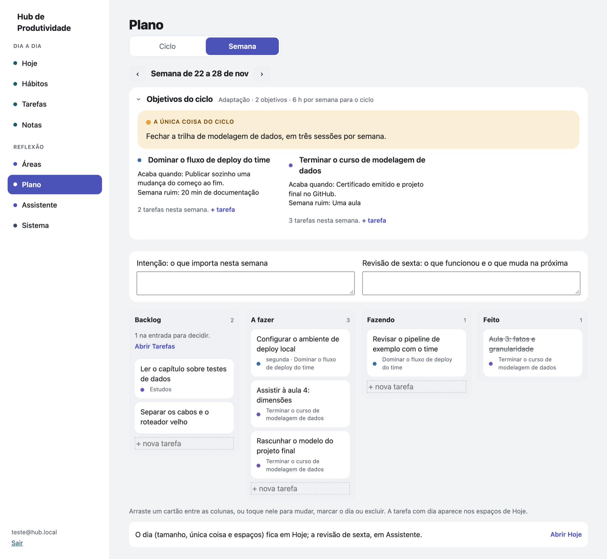
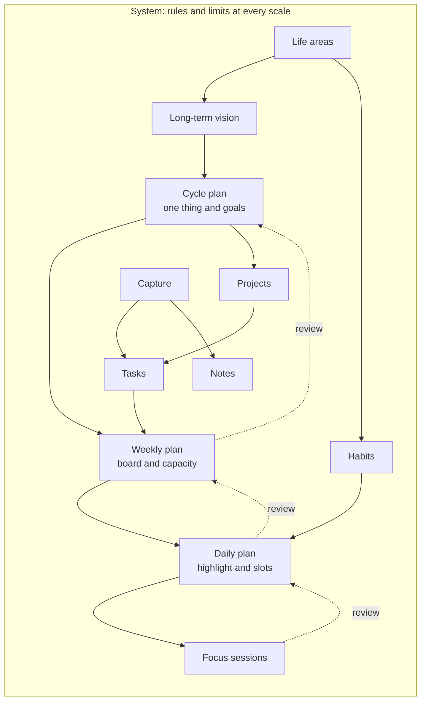
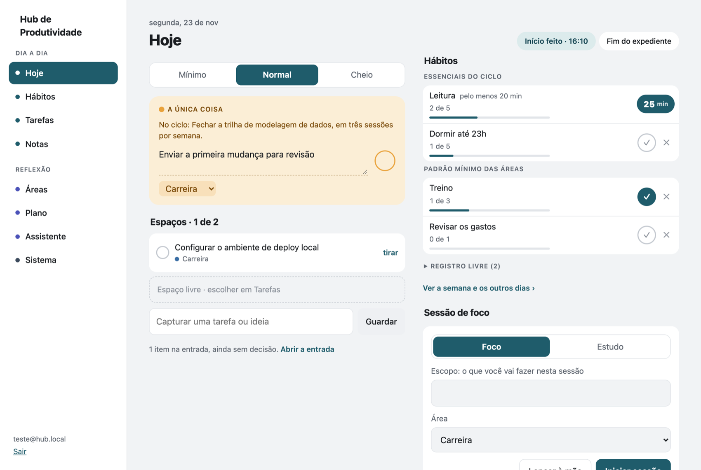
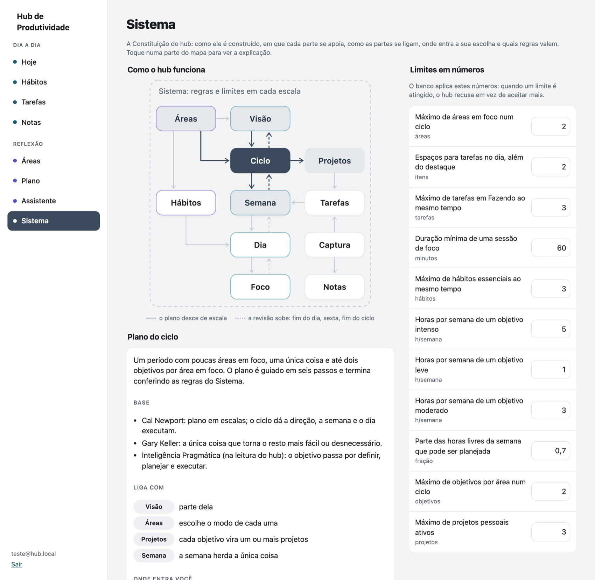
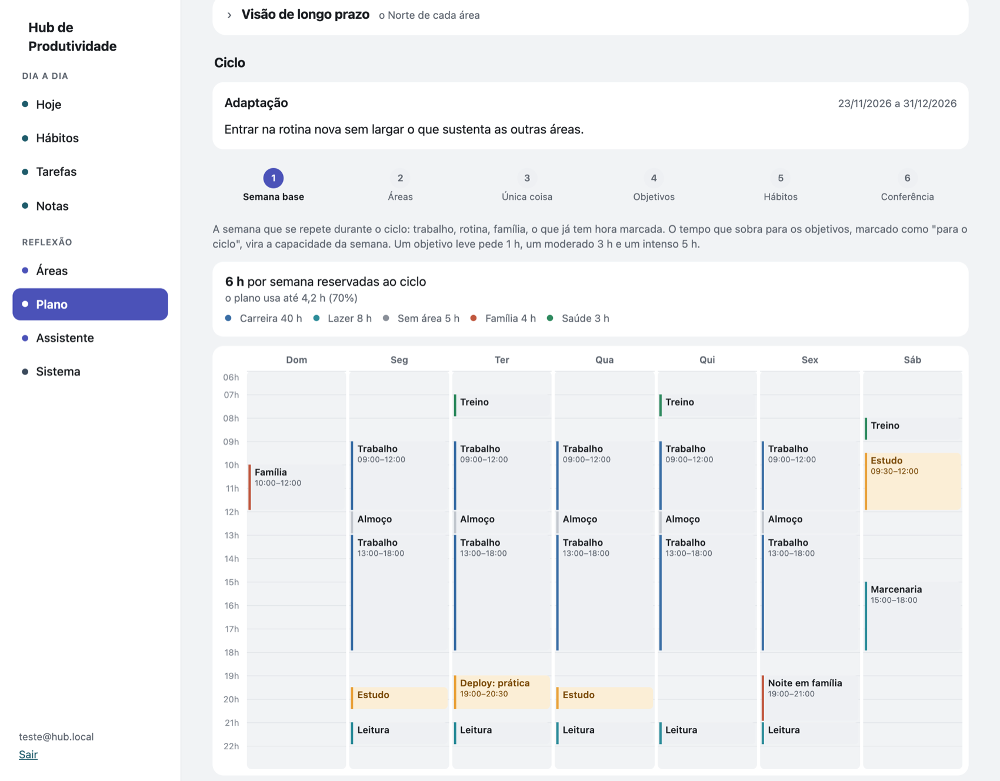
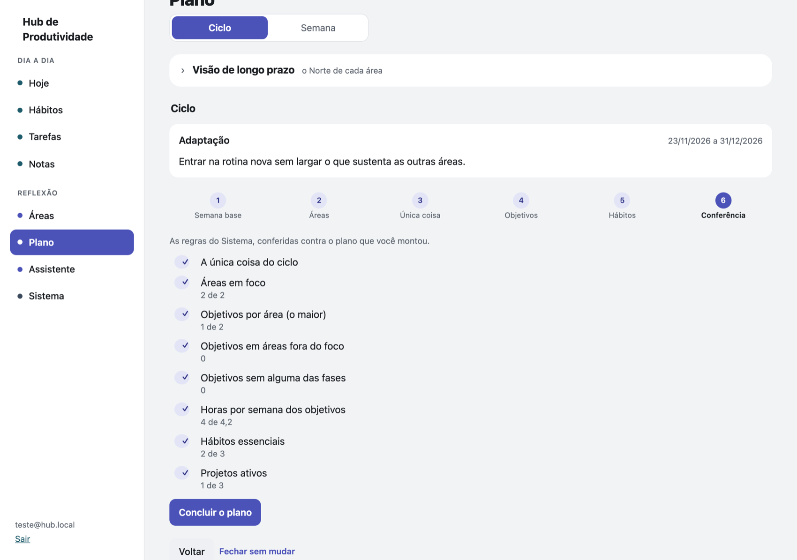
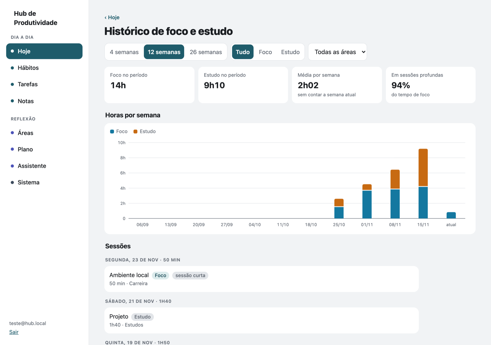
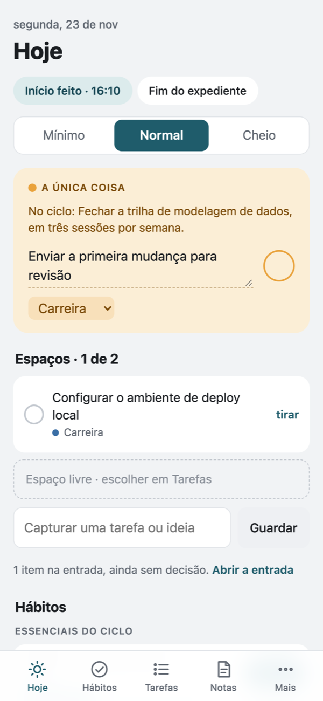
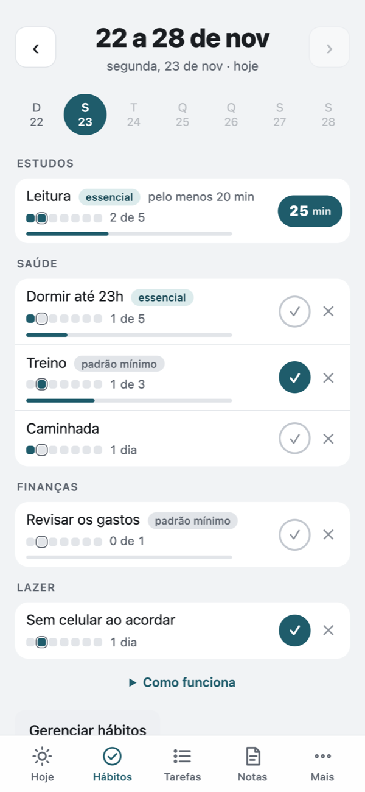

# Productivity Hub

**English** | [Português](README.pt-BR.md)

**A personal planning and habits system, with its business rules written in SQL and an AI assistant that reads everything and only proposes changes.**

React + TypeScript (PWA) · Postgres/Supabase with RLS · Deno Edge Functions · Claude API · Cloudflare

<p align="center">
  
</p>

<sub>The app's interface is in Portuguese. All screens use fictional data.</sub>

> Public showcase. Development happens in a private repository since November 16, 2026 (24 commits as of this update); this one holds the code, the decision documents and the screens, without personal content.

## The problem

Tasks in one app, habits in a paper notebook, focus hours somewhere else, loose notes, goals scattered across spreadsheets. Each tool works on its own, and none of them talk to each other. Worse: stacking the rules of several productivity methods produced dozens of goals per month. Each one fit on its own; together, they didn't.

The hub starts from a simple idea: **map everything, commit to little.** It keeps the whole map, but limits how many things can be in play at the same time. When a limit is reached, the database refuses instead of accepting one more.

## The flow

Everything in the hub is a single flow: planning goes down in scale, from the long term to the focus session, and review goes back up.



Each link rests on an author (Cal Newport, Gary Keller, Tiago Forte, David Allen, James Clear, among others), and the System screen explains the map: what each part does, where it comes from in theory, what it connects to, where the user's own choices come in and which rules apply.

## Screens

| | |
|---|---|
|  |  |
| **Today**: day size, the one thing, a capped number of task slots, habits by weight and a focus session. | **System**: the hub's "Constitution" as a clickable map, with the theory behind each part and editable limits. |
|  |  |
| **Cycle plan, step 1**: the base week. Blocks reserved for the cycle become the week's capacity. | **Cycle plan, step 6**: every System rule checked against the plan, computed in the database. |

<p align="center">
  
</p>

**Focus and study history**: hours per week, by type and by area, with the share done in long sessions.

<p align="center">
  
  &nbsp;&nbsp;
  
</p>

On mobile, the app is installable (PWA), with a bottom tab bar and one column at a time.

## Engineering decisions

**Business rules live in the database.** The app doesn't decide whether a day counts toward a weekly habit goal, whether another area fits in focus, or how many hours a cycle has. That is SQL: views for reading, functions for writing and triggers for limits. The app reads `v_*` views, calls functions and, when the database refuses with `raise exception`, shows the message it returns, already written for the user.

- 14 numbered migrations, no ORM: 22 tables, 10 views, 37 functions and 12 triggers.
- Every table has row-level security; without a login, the API reads nothing.
- Examples of rules: at most 2 areas in focus and 2 goals per area, at most 3 tasks in "Doing", a task whose day has passed goes back to the map instead of becoming "overdue", and the week's capacity is the sum of the blocks reserved for the cycle (kept in sync by a trigger).
- `conferir_ciclo()` returns every System rule with its value, its limit and whether it holds: the check screen only draws the result.

**One semantic layer for people and for the AI.** The same views the screens use feed the assistant: `revisao_da_semana()` returns the whole week as JSON, and a habit's weekly goal has a single definition (`v_habito_registro`), used everywhere.

**An assistant that proposes, never executes.** Two Edge Functions (Deno + TypeScript) call the Claude API:

- **Weekly review**: structured output (JSON Schema), validated before it reaches the screen. At most 3 observations and 3 proposals, every number quoted must exist in the data, and proposed ids and values are checked against the catalog.
- **Chat**: 9 read tools with strict schemas (week, area, habit, focus, project, notes, System...) and a `propose` tool. The loop has a round limit, and the history is stored exactly as the API returns it.
- Nothing changes in the hub until the user accepts: a proposal becomes a change through `decidir_proposta()`, with the login of whoever decides, and the limit triggers still apply.
- The API key lives only in Supabase secrets; authentication is checked in the function code.

**Lightness as a product requirement.** Every new feature goes through one question: does it reduce simultaneous commitments, or does it add pressure? That's why there are no streaks to break, there is a "minimum day", a habit's minimum version counts, and the plan only uses 70% of the free hours.

## How the project is run

- **Docs first.** Before code, a brief and the decisions in [`docs/`](docs) (in Portuguese): the data model, the build order, how modules connect, the assistant's architecture and the adjusted flow. When a decision changes, the document changes with it.
- **Breadth before depth.** First every module in a minimal cut, connected to the others; then each one gets deeper. A perfect, isolated module is just one more place to log things.
- **Short cycles with the real user.** Each batch is tested on the local database and in the browser (desktop and mobile, light and dark), shown locally and only then published. Usage feedback becomes the next batch.
- **Pair programming with AI.** The project is built with [Claude Code](https://claude.com/claude-code): I define the product, the rules and the order, and review what goes in; the agent implements, tests and documents. Commits record the co-authorship.
- **Personal data stays out of the repository.** Personal content lives in the database and in a folder outside git; the repository only holds structure, and the screens above use fictional data.

## Stack

| Layer | Choice |
|---|---|
| Database and rules | Postgres (Supabase): SQL migrations, views with `security_invoker`, plpgsql functions, triggers, RLS |
| App | React 19, TypeScript, Vite, PWA (vite-plugin-pwa), hand-written CSS with light and dark themes |
| AI | Claude API on Supabase Edge Functions (Deno): structured outputs, strict-schema tools, prompt caching |
| Deployment | Cloudflare Workers (static assets) on every push to `main`; migrations with `supabase db push` |
| Quality | `tsc`, oxlint, Prettier; backups with a test restore (`scripts/backup.sh --testar`) |

```
app/                  the app (screens in src/telas, shared pieces in src/componentes)
supabase/migrations/  the database, as numbered SQL
supabase/functions/   the assistant (weekly review and chat)
supabase/seed.sql     initial areas and limits
scripts/              content loading, batch amendments, backup
docs/                 decisions and specifications
```

## Running locally

Requires Docker (or Colima), the Supabase CLI and Node.

```bash
supabase start
supabase db reset
scripts/preparar_app_local.sh
npm --prefix app install
npm --prefix app run dev
```

The app opens at `http://localhost:5174`, pointing to the local database, with a test user created by the script.

## Documents (in Portuguese)

- [`docs/06-fluxo-ajustado.md`](docs/06-fluxo-ajustado.md): the current flow, the phases done and the next ones.
- [`docs/05-assistente.md`](docs/05-assistente.md): the AI assistant's architecture.
- [`docs/04-integracao.md`](docs/04-integracao.md): what connects the modules.
- [`docs/02-modelo-de-dados.md`](docs/02-modelo-de-dados.md): tables and conventions.
- [`CLAUDE.md`](CLAUDE.md): the project rules, for people and for the agent.

## Status

In use and under construction. Next steps: time blocks in the day drawn from the base week, focus sessions linked to tasks, and connected reviews (end of day, Friday and end of cycle) with the assistant.
