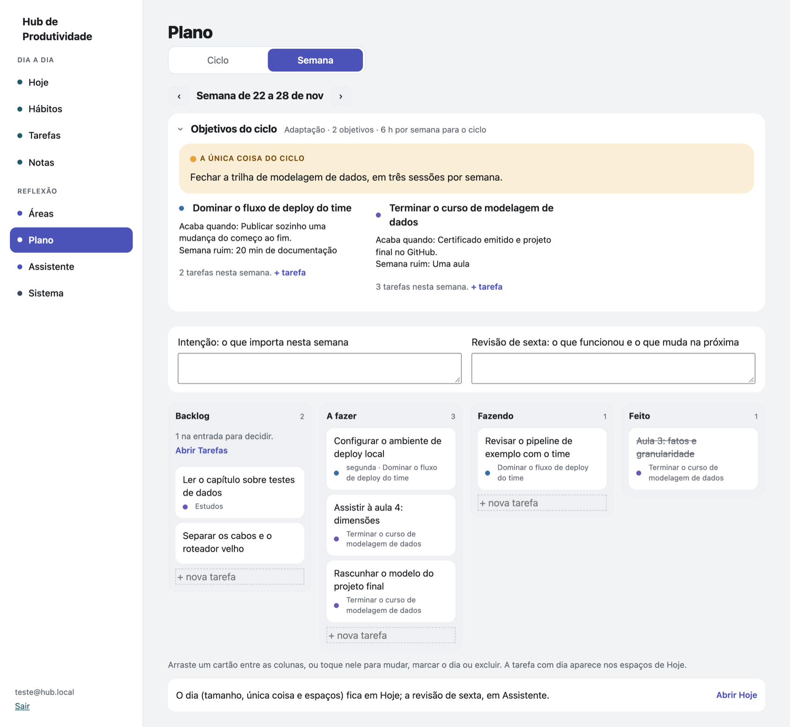
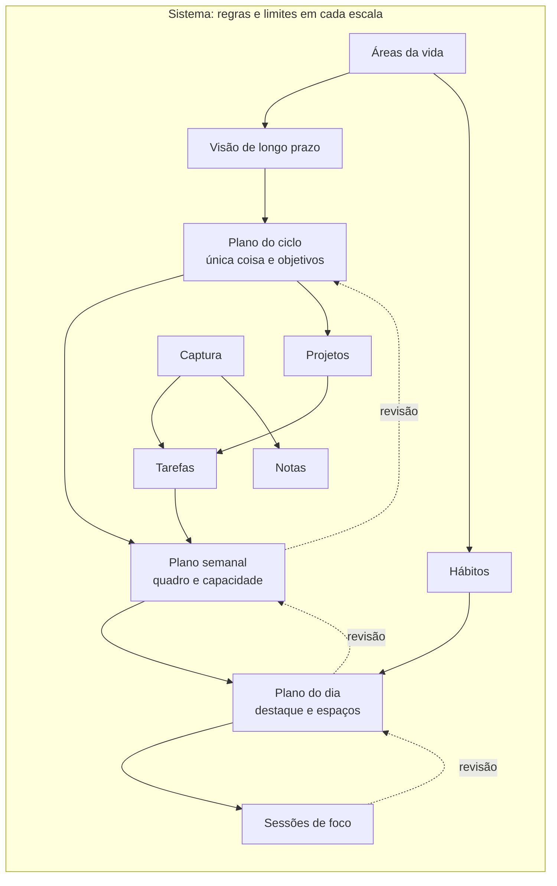
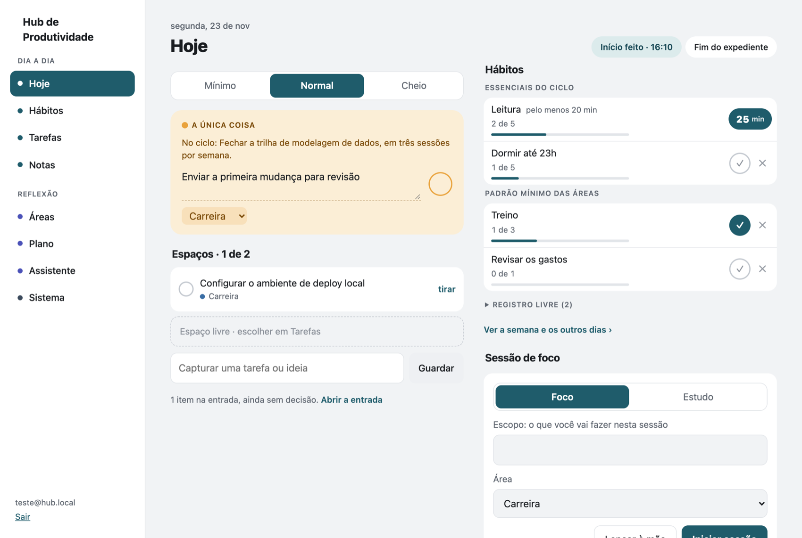
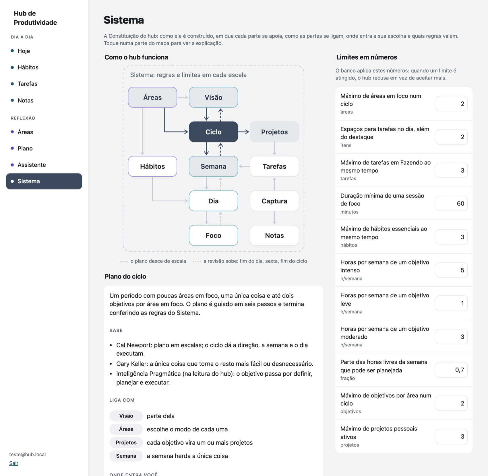
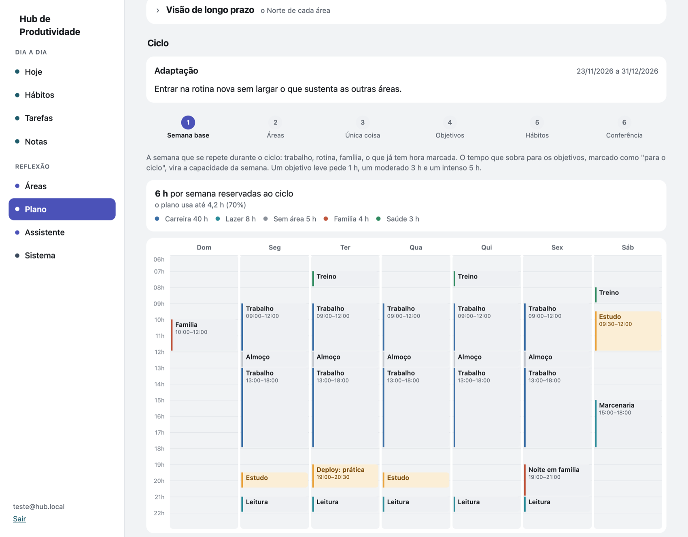
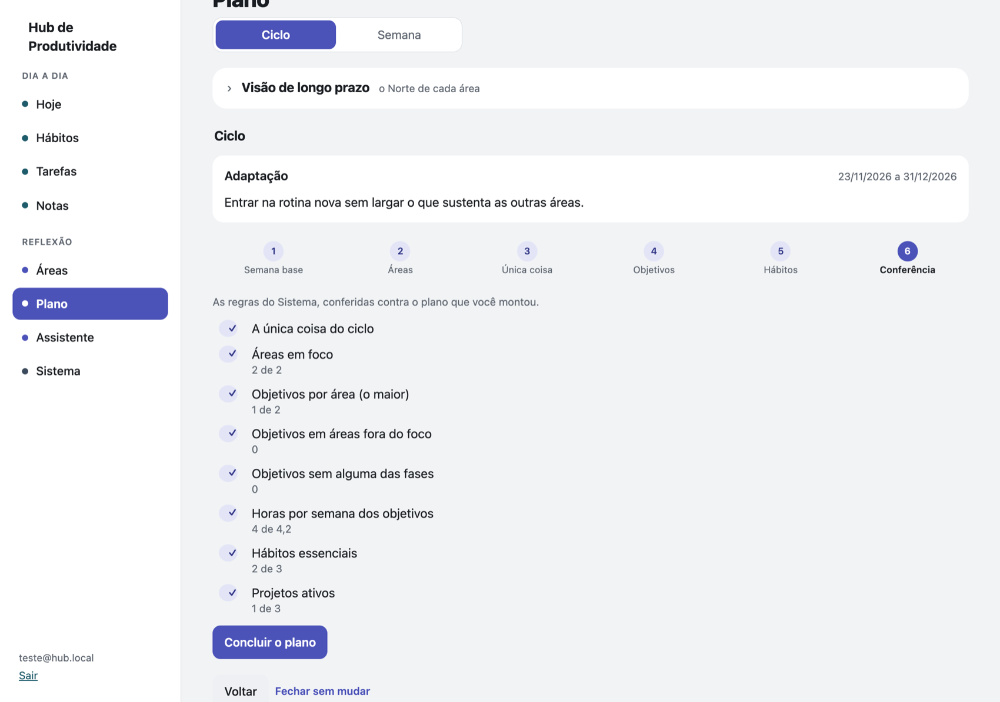
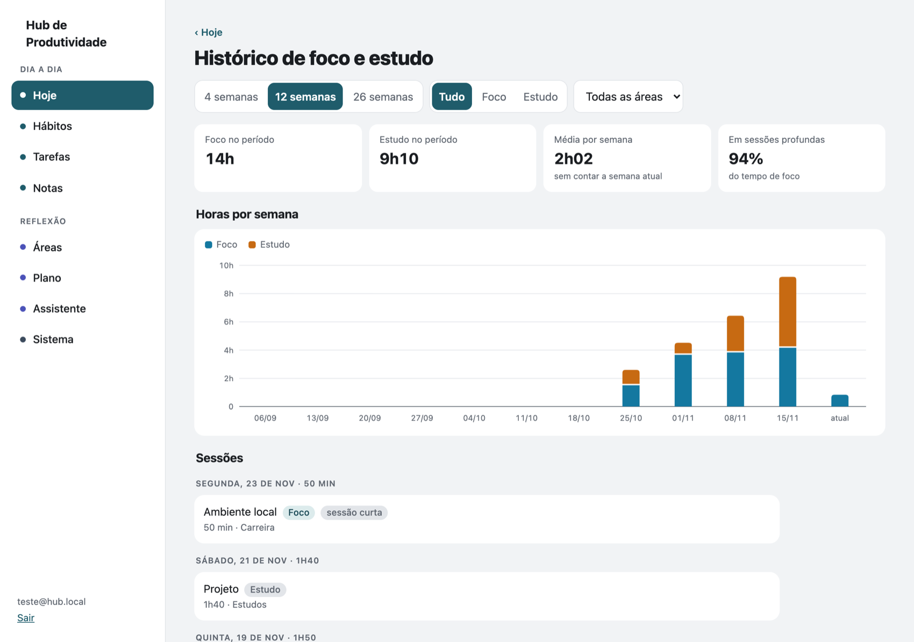
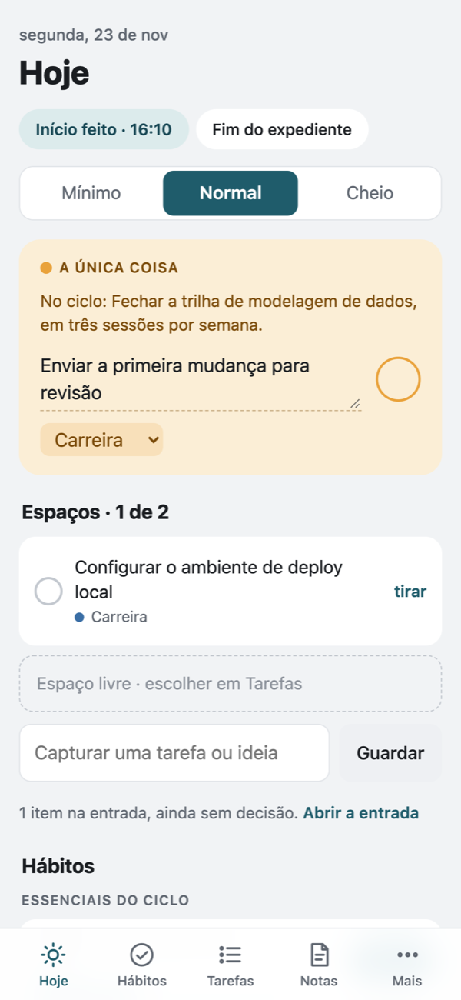
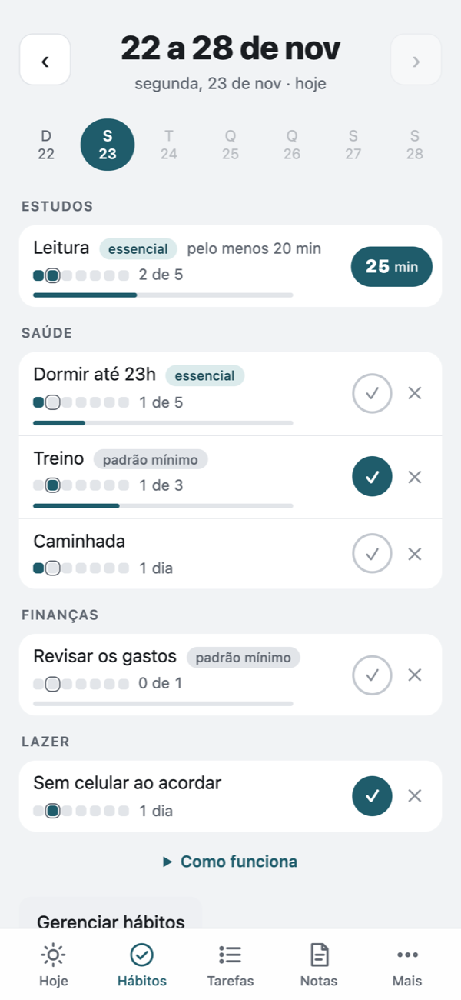

# Hub de Produtividade

[English](README.md) | **Português**

**Um sistema pessoal de planejamento e hábitos, com as regras de negócio escritas em SQL e um assistente de IA que lê tudo e só propõe.**

React + TypeScript (PWA) · Postgres/Supabase com RLS · Edge Functions em Deno · Claude API · Cloudflare

<p align="center">
  
</p>

> Vitrine pública. O desenvolvimento acontece num repositório privado desde 16/11/2026 (23 commits até esta atualização); aqui ficam o código, os documentos de decisão e as telas, sem o conteúdo pessoal.

## O problema

Tarefas num app, hábitos num caderno, horas de foco em outro, notas soltas, metas espalhadas por planilhas. Cada ferramenta funciona sozinha, e nenhuma conversa com a outra. Pior: somando as regras de vários métodos de produtividade, o plano pedia dezenas de metas por mês. Cada uma cabia sozinha; o conjunto, não.

O hub parte de uma ideia simples: **mapear tudo e se comprometer com pouco.** Ele guarda o mapa inteiro, mas limita quantas coisas podem estar em jogo ao mesmo tempo. Quando um limite é atingido, o banco recusa em vez de aceitar mais uma.

## O fluxo

Tudo no hub é um fluxo só: o plano desce de escala, do longo prazo até a sessão de foco, e a revisão sobe.



Cada elo se apoia num autor (Cal Newport, Gary Keller, Tiago Forte, David Allen, James Clear, entre outros), e a tela Sistema explica o mapa: o que cada parte faz, de onde vem na teoria, com o que se liga, onde entra a escolha da pessoa e quais regras valem.

## Telas

| | |
|---|---|
|  |  |
| **Hoje**: tamanho do dia, a única coisa, espaços de tarefa contados, hábitos por peso e sessão de foco. | **Sistema**: a "Constituição" do hub como mapa clicável, com a base teórica de cada parte e os limites editáveis. |
|  |  |
| **Plano do ciclo, passo 1**: a semana base. Os blocos reservados ao ciclo viram a capacidade da semana. | **Plano do ciclo, passo 6**: cada regra do Sistema conferida contra o plano, calculada no banco. |

<p align="center">
  
</p>

**Histórico de foco e estudo**: horas por semana, por tipo e por área, com a parte feita em sessões longas.

<p align="center">
  
  &nbsp;&nbsp;
  
</p>

No celular, o app é instalável (PWA), com abas no rodapé e uma coluna por vez.

## Decisões de engenharia

**Regra de negócio mora no banco.** O app não decide se um dia conta para a meta da semana, se cabe mais uma área em foco ou quantas horas o ciclo tem. Isso é SQL: views para leitura, funções para escrita e gatilhos para os limites. O app lê `v_*`, chama funções e, quando o banco recusa com `raise exception`, mostra a mensagem que já vem escrita para a pessoa.

- 14 migrations numeradas, sem ORM: 22 tabelas, 10 views, 37 funções e 12 gatilhos.
- Toda tabela tem row-level security; sem login, a API não lê nada.
- Exemplos de regra: no máximo 2 áreas em foco e 2 objetivos por área, no máximo 3 tarefas em "Fazendo", tarefa com dia no passado volta para o mapa em vez de virar "atrasada", e a capacidade da semana é a soma dos blocos reservados ao ciclo (mantida por gatilho).
- `conferir_ciclo()` devolve cada regra do Sistema com valor, limite e se está dentro: a tela de conferência só desenha o resultado.

**Uma camada semântica para pessoas e para a IA.** As mesmas views que a tela usa alimentam o assistente: `revisao_da_semana()` devolve a semana inteira em JSON, e a meta semanal de um hábito tem uma única definição (`v_habito_registro`), usada por todos.

**Um assistente que propõe, não executa.** Duas Edge Functions (Deno + TypeScript) usam a Claude API:

- **Revisão da semana**: saída estruturada (JSON Schema), validada antes de chegar à tela. No máximo 3 observações e 3 propostas, todo número citado precisa existir nos dados, e os ids e valores propostos são conferidos contra o catálogo.
- **Conversa**: 9 ferramentas de leitura com esquema estrito (semana, área, hábito, foco, projeto, notas, Sistema...) e uma ferramenta `propor`. O laço tem limite de rodadas, e o histórico é guardado exatamente como volta da API.
- Nada muda no hub sem a pessoa aceitar: a proposta vira mudança por `decidir_proposta()`, com o login de quem decide, e os gatilhos de limite continuam valendo.
- A chave da API fica só nos segredos do Supabase; a autenticação é conferida no código da função.

**Leveza como requisito de produto.** Toda função nova passa por uma pergunta: ela reduz compromissos simultâneos ou acrescenta cobrança? Por isso não há sequência de dias a quebrar, existe o "dia mínimo", a versão mínima de um hábito conta, e o plano usa só 70% das horas livres.

## Como o projeto é tocado

- **Docs primeiro.** Antes do código, um briefing e as decisões em [`docs/`](docs): o modelo de dados, a ordem de construção, a integração entre módulos, a arquitetura do assistente e o fluxo ajustado. Quando uma decisão muda, o documento muda junto.
- **Largura antes de profundidade.** Primeiro todos os módulos em corte mínimo e ligados entre si; depois o aprofundamento de cada um. Um módulo perfeito e isolado é só mais um lugar para registrar.
- **Ciclos curtos com o usuário real.** Cada lote é testado no banco local e no navegador (computador e celular, claro e escuro), mostrado localmente e só então publicado. O feedback de uso vira o próximo lote.
- **Par de programação com IA.** O projeto é feito com o [Claude Code](https://claude.com/claude-code): eu defino o produto, as regras e a ordem, e reviso o que entra; o agente implementa, testa e documenta. Os commits registram a coautoria.
- **Dados pessoais fora do repositório.** Conteúdo pessoal fica no banco e numa pasta fora do git; o repositório tem só estrutura, e as telas acima usam dados fictícios.

## Stack

| Camada | Escolha |
|---|---|
| Banco e regras | Postgres (Supabase): migrations em SQL, views com `security_invoker`, funções plpgsql, gatilhos, RLS |
| App | React 19, TypeScript, Vite, PWA (vite-plugin-pwa), CSS próprio com tema claro e escuro |
| IA | Claude API em Supabase Edge Functions (Deno): saídas estruturadas, ferramentas com esquema estrito, cache de prompt |
| Publicação | Cloudflare Workers (arquivos estáticos), a cada push na `main`; migrations com `supabase db push` |
| Qualidade | `tsc`, oxlint, Prettier; backup com restauração de teste (`scripts/backup.sh --testar`) |

```
app/                  o app (telas em src/telas, peças comuns em src/componentes)
supabase/migrations/  o banco, em SQL numerado
supabase/functions/   o assistente (revisão da semana e conversa)
supabase/seed.sql     áreas e limites iniciais
scripts/              carga de conteúdo, emendas em lote, backup
docs/                 decisões e especificações
```

## Rodar localmente

Precisa de Docker (ou Colima), do Supabase CLI e do Node.

```bash
supabase start
supabase db reset
scripts/preparar_app_local.sh
npm --prefix app install
npm --prefix app run dev
```

O app abre em `http://localhost:5174`, apontando para o banco local, com um usuário de teste criado pelo script.

## Documentos

- [`docs/06-fluxo-ajustado.md`](docs/06-fluxo-ajustado.md): o fluxo atual, as fases feitas e as próximas.
- [`docs/05-assistente.md`](docs/05-assistente.md): a arquitetura do assistente de IA.
- [`docs/04-integracao.md`](docs/04-integracao.md): o que liga os módulos.
- [`docs/02-modelo-de-dados.md`](docs/02-modelo-de-dados.md): tabelas e convenções.
- [`CLAUDE.md`](CLAUDE.md): as regras do projeto, para pessoas e para o agente.

## Estado

Em uso e em construção. Próximos passos: blocos de tempo no dia saindo da semana base, sessões de foco ligadas às tarefas e revisões amarradas (fim do dia, sexta e fim do ciclo) com o assistente.
